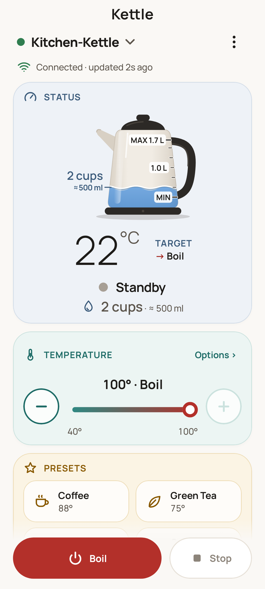
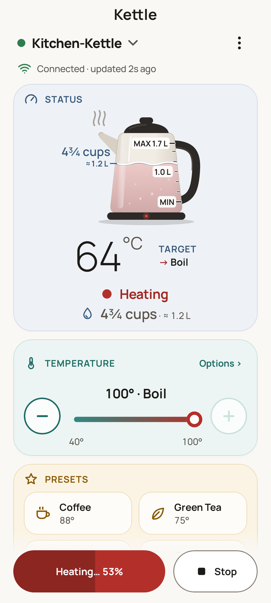
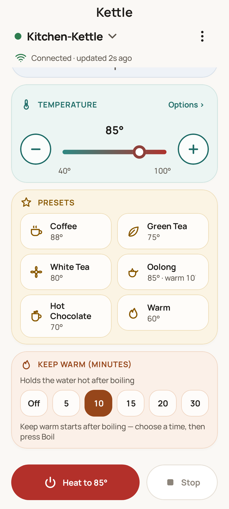
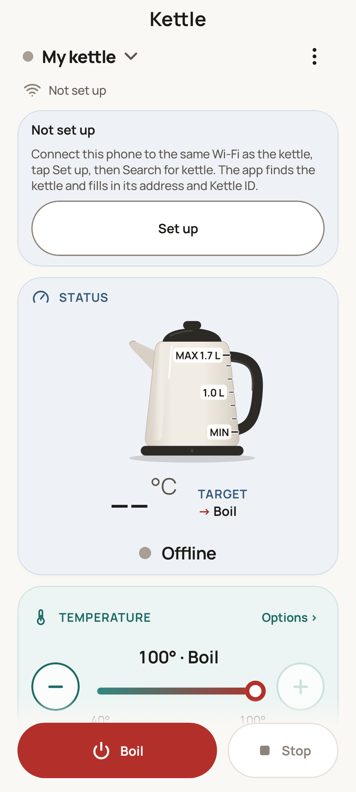

# AppKettle Revival — Android app and tools for AppKettle smart kettles

An Android app to control your AppKettle kettle from your phone over your home Wi-Fi — no cloud, no account. It works even though the maker and its cloud service are gone. Also included: a step-by-step guide to reconnect a kettle to Wi-Fi, and simple laptop tools.

1. **[The Android app](#get-the-app)**: boil, temperature, keep-warm, presets, live status. Install it from the **Releases** page ([how](#get-the-app)).
2. **[The re-pairing guide](docs/re-pairing.md)**: put a kettle back on Wi-Fi without the original app.
3. **[Laptop tools (Python)](tools/README.md)**: for advanced users.

Not technical? An AI assistant can walk you through it — see [below](#stuck-ask-an-ai-assistant).

> **Unofficial.** This project is not affiliated with, endorsed by or supported by the kettle's maker or its suppliers. "AppKettle" is used only to say which kettles this works with (see [TRADEMARK.md](TRADEMARK.md)).
>
> **Provided as is, without warranty and without support.** Issues may not be answered. The documentation is meant to be enough on its own: start with the [FAQ](docs/faq.md).
>
> **Read [Safety](#safety) before you use it.**

In more detail:

| | |
|---|---|
| [**Android app**](android-app/) | Boil, heat to a temperature, keep warm, presets, live temperature and water level. Finds the kettle on your network by itself. Android 8+ |
| [**Re-pairing guide**](docs/re-pairing.md) | Put a kettle on a new Wi-Fi network without the original app. A proven, step-by-step method using an Android phone hotspot |
| [**Python tools**](tools/) | `kettle.py` (find, status, boil, off, keep warm, scan) and `smartconfig_send.py` (pairing). Standard library only |
| [**Protocol**](docs/protocol.md) | The local protocol (TCP 6002), the pairing scheme, and which commands must never be sent |

<p>




</p>

*(The screenshots are rendered from test data, not taken on a phone.)*

## Safety

- A kettle is a **plug-in (AC-powered) appliance that boils water**. Remote control adds risk: the kettle can switch on when nobody expects it.
- **Don't boil unattended.** Only switch the kettle on remotely when someone is with it, or you know it is safe (on its base, nothing touching it, lid closed).
- **Check the water level** before boiling: at least the MIN mark (250 ml), at most MAX (1.7 L). The app and the tools refuse below 250 ml unless you override it.
- **Never open the kettle or its base**, and don't use it if the cord, base or kettle is damaged.
- Keep the kettle's network private: the local protocol has no password (see [SECURITY.md](SECURITY.md)).
- **Use at your own risk.** The software is provided as is, with no warranty of any kind (see [LICENSE](LICENSE)).

## Get the app

**Easiest:** download `appkettle-revival-<version>.apk` from the project's **Releases** page (GitHub: `https://github.com/narthexfire/appkettle-revival/releases` · Codeberg: `https://codeberg.org/narthexfire/appkettle-revival/releases`). Then:

1. **Check the download** (optional but recommended). Each release lists the file's SHA-256 in `SHA256SUMS.txt`. Compare it with yours:
   - Windows: `certutil -hashfile appkettle-revival-1.0.0.apk SHA256`
   - macOS: `shasum -a 256 appkettle-revival-1.0.0.apk`
   - Linux: `sha256sum appkettle-revival-1.0.0.apk`
2. **Install.** Open the APK on the phone. Allow **"Install unknown apps"** for your browser or file manager when Android asks. Google Play Protect may warn that the app is from an unknown developer; that is normal for apps installed outside the Play Store. Choose "Install anyway" only if the SHA-256 matched.
3. **Update** later by installing a newer APK from the same Releases page over the old one; your settings are kept.

The app appears on your phone as **Kettle** (package `io.github.narthexfire.kettle`).

**Signing certificate.** Every official APK is signed with the same key. Its certificate SHA-256 is:

```
8c6b76ffef32136a994ea1131c049245bb51677ab7f5f18f5fa1563cdce9dffc
```

To check an APK before installing or updating (needs the Android SDK build-tools or a JDK):

```
apksigner verify --print-certs appkettle-revival-1.0.0.apk     # "Signer #1 certificate SHA-256 digest"
keytool -printcert -jarfile appkettle-revival-1.0.0.apk        # "SHA256:" (shown with colons)
```

The digest must match the one above (ignore colons and upper/lower case). Android itself also refuses to update the app with an APK signed by a different key.

**Building from source is optional** (needs JDK 17+ and the Android SDK): see [android-app/README.md](android-app/README.md).

There is no iPhone app. On a computer, use the [Python tools](tools/).

## Quick start

**1. Is the kettle on your Wi-Fi?**

- Wi-Fi light steady and it worked on this network before: probably yes. Go to step 2.
- Display and light off: press **Power** on the base (after 20 minutes without Wi-Fi the kettle sleeps), then check again.
- New router, new Wi-Fi name or password, or moved: follow **[docs/re-pairing.md](docs/re-pairing.md)** first. You need an Android phone, a computer with Python 3, and about 15 minutes.

**2a. With the Android app**

1. Install the app (see [Get the app](#get-the-app)).
2. Put the phone on the kettle's Wi-Fi.
3. Open the app (it's called **Kettle** on your phone). On the **Not set up** card, tap **Set up**, then **Search for kettle**.

The app finds the kettle, fills in its address and ID, and connects. (Later, the same screen is under ⋮ → **Settings** → your kettle.)

**2b. With a computer** (Python 3.8+, from the `tools` folder; on macOS/Linux type `python3`, on Windows `py` works too):

```
python kettle.py find                         # finds kettles on this network, read-only
python kettle.py status --host 192.168.1.50   # use the address that find printed
python kettle.py boil   --host 192.168.1.50   # or: --temp 80 --keep-warm 10
python kettle.py off    --host 192.168.1.50
```

**If the search / `find` finds nothing:** open your router's (or phone hotspot's) list of connected devices and look for a device whose MAC address (the device's hardware network ID) starts with **`00:26:29`**. That device's IP address is the kettle's: type it into the app (Settings → your kettle → IP address → Test connection) or use it with `--host`. Not listed at all? The kettle isn't on that network: [re-pair it](docs/re-pairing.md). More in the [FAQ](docs/faq.md#step-by-step-why-cant-i-reach-my-kettle).

## Stuck? Ask an AI assistant

There is no support for this project, but an AI coding assistant (Claude Code is one example) can walk you through installation and troubleshooting step by step. Point it at this repository and its docs (README.md, docs/re-pairing.md, docs/faq.md, tools/README.md). Tell it your phone, your computer and what your kettle's Wi-Fi light is doing, and ask it to guide you. For example:

```
I have an AppKettle smart kettle whose app/cloud no longer works. Using the docs in this
repository (https://github.com/narthexfire/appkettle-revival), help me step by step to:
1) put the kettle on my home Wi-Fi, 2) install the Android app, 3) connect to it.
My phone is <Android model>, my computer is <Windows/Mac>.
The kettle's Wi-Fi light is <steady / slow flashing / fast flashing / off>.
Ask me one step at a time and wait for my answer.
```

Stay safe:

- Never run a command you don't understand. Ask the assistant to explain it first.
- Never send the never-send commands (0x47 firmware update, 0x35 serial-number write); the tools refuse them, and so should you.
- Never paste your Wi-Fi password into a public place.

## Requirements

- The kettle's Wi-Fi network must be **2.4 GHz** and **WPA2-Personal**, with a password of **8–32 letters and digits only**.
- Control is local. Your phone or computer must be on the same network as the kettle, or connected to it through a VPN.

## Limitations

- **Unofficial**, and tested on **one kettle model and firmware**. Other batches may differ.
- **No timers or schedules**, no voice assistants, no remote access over the internet.
- **No iPhone app.**
- Firmware updates are impossible (the vendor's servers are gone). The tools and the app can never send the firmware-update (0x47) or serial-number-write (0x35) commands.
- The pairing sender ends with **"no RMTConfigSuccess reply" and exit code 2 even when pairing worked**: kettles don't send that reply. Check the network instead.
- `--temp` of **90 or more is treated as "boil"** (sent as 100; the kettle stops at the real boil, which is below 100 °C at altitude).
- Pairing only works through an **Android phone hotspot** (see [re-pairing.md](docs/re-pairing.md#troubleshooting)).

## Documentation

- [Re-pairing (Wi-Fi setup)](docs/re-pairing.md)
- [FAQ and troubleshooting](docs/faq.md)
- [Protocol](docs/protocol.md)
- [How it was figured out](docs/how-it-was-figured-out.md)
- [Python tools](tools/README.md) · [Android app](android-app/README.md)

## License and credits

MIT. See [LICENSE](LICENSE). This builds on public work by others, credited in [NOTICE](NOTICE). Security reports: [SECURITY.md](SECURITY.md). Contributing: [CONTRIBUTING.md](CONTRIBUTING.md).

Home: `https://github.com/narthexfire/appkettle-revival` · Mirror: `https://codeberg.org/narthexfire/appkettle-revival`
