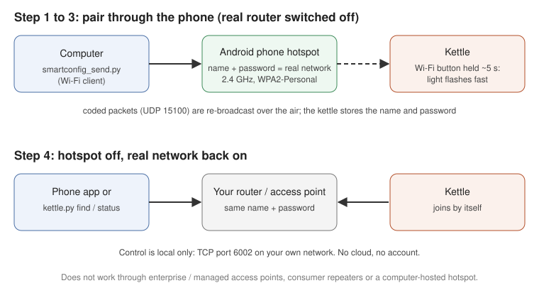

# Putting a kettle on a Wi-Fi network (re-pairing)

Use this guide when the kettle isn't on any Wi-Fi network you can reach. That happens when:

- the network it used is gone (new router, new home, new password), or
- you want to move it to another network.

The original app is gone. This guide replaces its pairing screen.

Not technical? An AI assistant can walk you through it step by step — see [Stuck? Ask an AI assistant](../README.md#stuck-ask-an-ai-assistant).

**If the kettle already works on your network, you don't need any of this.** Go straight to the app or `tools/kettle.py find`.



Contents:

- [What you need](#what-you-need)
- [Setting up Python (first time only)](#setting-up-python-first-time-only)
- [Phone hotspot gotchas](#phone-hotspot-gotchas)
- [Know your kettle](#know-your-kettle)
- [Method A: the proof run](#method-a-prove-that-pairing-works-pair-to-the-phone-hotspot-itself)
- [Method B: name the hotspot like your network](#method-b-name-the-hotspot-like-your-real-network-recommended) (the recommended way)
- [Checking that it worked](#checking-that-it-worked)
- [Troubleshooting](#troubleshooting)
- [Method C: 0x3E](#method-c-last-resort-0x3e-over-an-existing-connection) (last resort)

---

## What you need

- **An Android phone that can share a mobile hotspot.** You must be able to set the hotspot's name, password, band and security. Most Android phones can. iPhone hotspots aren't tested and can't always be forced to 2.4 GHz.
- **A computer with Wi-Fi** (Windows, macOS or Linux) and **Python 3.8 or newer**. See [Setting up Python](#setting-up-python-first-time-only) below; nothing else needs installing.
- A copy of this project. You need the `tools/` folder.
  - On the project page, use **Code → Download ZIP** (GitHub) or the download button (Codeberg).
  - Unzip it somewhere easy, for example your Desktop.
- **The target network's name (SSID) and password.** They must meet these rules:
  - **2.4 GHz.** The kettle has no 5 GHz radio.
  - **WPA2-Personal (AES).** Not WPA3, not "WPA2/WPA3 transition", not WPA2-Enterprise.
  - **Password of 8–32 characters, letters and digits only.** No spaces or symbols.
  - SSID of 32 characters or fewer. Plain letters, digits and `-` are safest.
- The kettle on its base, plugged in. It doesn't need water.

If your router's main network breaks one of these rules, create a separate 2.4 GHz network for the kettle on the router (many routers call this a "guest" or "IoT" network). Choose plain WPA2 and a letters-and-digits password. Make sure devices on it can reach the device you'll control the kettle from, or put your phone on that network too. Conservative settings are channel 1, 6 or 11, and 20 MHz width.

## Setting up Python (first time only)

1. **Install Python 3** from [python.org/downloads](https://www.python.org/downloads/).
   - **Windows:** in the installer, check **"Add python.exe to PATH"** before you click Install. If you forgot, use `py` instead of `python` in every command below.
   - **macOS:** use `python3` instead of `python` in every command below. macOS may offer to install the "command line developer tools" the first time; accept.
   - **Linux:** Python 3 is usually installed already; use `python3`.
2. **Open a terminal:**
   - **Windows:** press Start, type `cmd`, press Enter.
   - **macOS:** open **Terminal** (Applications → Utilities).
   - **Linux:** open your terminal app.
3. **Go to the tools folder.** Type `cd ` (with a space), drag the unzipped `tools` folder onto the terminal window, and press Enter. For example:
   ```
   cd Desktop\appkettle-revival-main\tools                       (Windows, from your home folder)
   cd ~/Desktop/appkettle-revival-main/tools                       (macOS / Linux)
   ```
4. **Check it works:**
   ```
   python smartconfig_send.py --help        (Windows; or: py smartconfig_send.py --help)
   python3 smartconfig_send.py --help       (macOS / Linux)
   ```
   You should see the help text.

**Finding your computer's IP address on the hotspot** (you need it for `--iface-ip`). Connect to the hotspot first. Then:

- **Windows:** run `ipconfig`. Use the "IPv4 Address" under **Wireless LAN adapter Wi-Fi** (not Ethernet, not a VPN).
- **macOS:** System Settings → Wi-Fi → **Details…** next to the connected network → TCP/IP shows the IP address. Or in Terminal: `ipconfig getifaddr en0`. If that prints nothing, run `networksetup -listallhardwareports`, find the "Wi-Fi" entry's device (e.g. `en1`), and use `ipconfig getifaddr en1`.
- **Linux:** `ip -4 addr` and use the address on the wireless interface (usually `wlan0` or `wlp…`).

It usually looks like `192.168.43.x`, `172.20.10.x` or `10.x.x.x`.

## Phone hotspot gotchas

- **Band.** The kettle needs **2.4 GHz**. Some phones call this option "Extend compatibility", "Maximize compatibility" or "2.4 GHz band"; others offer "2.4 and 5 GHz" (that's fine too). Avoid "5 GHz only".
- **Security.** Choose **WPA2-Personal**. Many phones default to **WPA2/WPA3** or **WPA3**; change it.
- **Client isolation.** Many Android hotspots stop connected devices from talking to each other. Pairing still works, but your computer can't see the kettle while both are on the hotspot. Check the phone's **connected devices** list instead (a device whose MAC address (the device's hardware network ID) starts with `00:26:29`), or use Method B and check on your real network.
- **Auto-off.** Some phones switch the hotspot off when nothing is connected for a few minutes. Keep the computer connected and start the sender soon after turning the hotspot on.
- **Cellular data.** The hotspot doesn't need to share internet. If your phone refuses to start a hotspot without a data connection, turn cellular data on; nothing is downloaded by this process.

## Know your kettle

- **Wi-Fi button, held:** press and hold it for **about 5 seconds (or longer)** until the Wi-Fi light **flashes fast**, then release it. This is pairing mode.
  - If nothing sends pairing data, the kettle gives up after **about 50 seconds**, goes back to normal and rejoins the network it already knows.
  - So holding the button by mistake is harmless.
  - It also means a steady light after a pairing attempt proves nothing on its own.
- **Off mode:** after **about 20 minutes without Wi-Fi**, the display and the Wi-Fi light go dark.
  - Press **Power** on the base, or unplug and re-plug the base, to wake it.
  - Do this **just before** each attempt.
- **Its ID:** every kettle reports an ID like `GD0-xxxxx-xxxx`. Network-wise, its MAC address starts with `00:26:29`. You'll use these to recognize it.
- **There is no factory reset**, and you don't need one.

## Method A: prove that pairing works (pair to the phone hotspot itself)

Use this first if you want to check that your kettle and your computer can do it. The downside: the kettle ends up on the phone hotspot. Most phones isolate hotspot clients from each other, so you usually can't control the kettle there. Afterwards, do Method B.

1. **Phone hotspot.** Set a test name and password, for example `KettlePair` / `pair12345`. Set **Band: 2.4 GHz** and **Security: WPA2-Personal**, then turn the hotspot on.
2. **Computer.** Connect to the phone hotspot like any Wi-Fi network.
3. **Find the computer's address on the hotspot:**
   - **Windows:** run `ipconfig`. Use the "IPv4 Address" under the Wi-Fi adapter.
   - **macOS:** run `ipconfig getifaddr en0`.
   - **Linux:** run `ip -4 addr`.

   Details: [Finding your computer's IP address](#setting-up-python-first-time-only).
4. **Wake the kettle.** Press Power on the base.
5. **Start the sender.** In the `tools` folder:
   ```
   python smartconfig_send.py --ssid "KettlePair" --iface-ip <computer address> --duration 150
   ```
   - Type the password when asked.
   - On macOS the firewall may ask whether Python may accept incoming network connections: allow it (for the reply on UDP port 15100) or deny it; pairing works either way, and you check the hotspot's device list anyway.
   - On Windows the firewall may ask whether Python may use the network the first time. "Allow" is fine, and so is "Cancel": sending works either way.
6. **Within the first few seconds,** press and hold the kettle's **Wi-Fi button** for **about 5 seconds (or longer)** until its light **flashes fast**, then release it. Leave the kettle alone.
7. **Wait.** Within a minute or two the light goes steady. Let the sender run to the end.
8. **Check.** Open the phone's hotspot settings and look at **connected devices**. A device whose MAC address starts with `00:26:29` (or with no name) is the kettle. This list is sometimes slow or stale, so look again after a minute.

The sender listens for a reply from the kettle (`RMTConfigSuccess`). **In practice there is no reply, even when pairing works.** "no RMTConfigSuccess reply" at the end is normal.

## Method B: name the hotspot like your real network (recommended)

The kettle stores only a **network name and password**. Pairing works reliably only through a phone hotspot (see [Troubleshooting](#troubleshooting)). So:

1. Make the phone hotspot pretend to be your real network.
2. Pair the kettle to it.
3. Switch the hotspot off and the real network back on.

The kettle then joins the real network by itself. This puts the kettle on any compatible network. You don't need the old network, the old app or any special hardware.

1. **Switch the real network off for about 10 minutes.** Unplug the router or access point, or disable that SSID in its settings. Otherwise the computer, or the kettle, may connect to the real network instead of the phone. If the router also gives your computer internet, that's fine: the computer doesn't need internet for this.
2. **Phone hotspot.** Set:
   - **Name:** exactly the real network's name, including capitals and spaces
   - **Password:** exactly the real password
   - **Band:** 2.4 GHz
   - **Security:** WPA2-Personal

   Turn the hotspot on.
3. **Computer.** Connect to the phone hotspot. It has the same name as your network, so the computer may connect on its own. Note the computer's address (see Method A step 3).
4. **Wake the kettle.** Press Power on the base.
5. **Start the sender:**
   ```
   python smartconfig_send.py --ssid "<your network name>" --iface-ip <computer address> --duration 150
   ```
   Type the network's password when asked. To avoid typing it, you can use `--password-env VAR` to read it from an environment variable.
6. **Within the first few seconds,** press and hold the **Wi-Fi button** for **about 5 seconds (or longer)** until its light **flashes fast**, then release it.
7. **Wait** for the light to go steady and the sender to finish (150 s).
8. **Switch the phone hotspot off.** Switch the **real network back on.**
9. **Wait 2–3 minutes,** then [check that it worked](#checking-that-it-worked).

If it didn't work, repeat once, and press Power just before you start. Nothing is lost by trying: a kettle that didn't pair keeps its old settings.

## Checking that it worked

Use any of these. The kettle power-saves, so be patient: a single ping or a quick scan can miss it.

- **The router's client list** (its settings page) shows a new device whose MAC address starts with `00:26:29`. Its IP address is the kettle's. While you're there, ask the router to always give it the same address (a "DHCP reservation"). That makes life easier.
- **The app:** put the phone on the same Wi-Fi, open **Settings → your kettle → Search for kettle**.
- **The computer:** on the same Wi-Fi, run:
  ```
  python kettle.py find
  python kettle.py status --host <address found>
  ```

## Troubleshooting

**What didn't work, and the likely reason.** The sender's packets are identical in every case. Only the network that carries them differs.

| Sender's network | Result | Likely reason |
|---|---|---|
| **Android phone hotspot** (computer as a client) | **Worked** in every run that could be checked, including Method B | The phone re-broadcasts the packets in a form the kettle can read |
| Enterprise / managed access points | Failed | Such systems filter or convert broadcast and multicast traffic (e.g. "multicast-to-unicast", "broadcast filtering"), so the coded packets never reach the air as sent. They may also refuse simple IoT devices |
| Consumer repeater / extender | Failed | Same idea: group traffic isn't forwarded usably |
| Windows "Mobile hotspot" on the computer itself | Failed | Same idea. It also switches itself off after a few minutes with no devices connected |
| The kettle's current network, from a wired computer | Not expected to work | The packets must go out over the air |

All results come from one kettle, so treat them as a strong hint, not a guarantee. The explanations are inferences from the results; they were not measured. The practical rule: **send through an Android phone hotspot, and use Method B to reach your real network.**

**Other problems:**

- **The kettle never appears on the real network.**
  - Check the network against the rules: 2.4 GHz, WPA2-Personal (not WPA3/mixed), password of 8–32 letters and digits.
  - Check the name is spelled exactly the same, including capitals.
  - Some routers block new devices, or keep IoT devices away from your phone ("client isolation", "AP isolation"). Turn that off for the kettle's network.
- **The light never fast-flashes.** Press and hold the Wi-Fi button for about 5 seconds (or longer) until its light flashes fast, then release it. Press Power first to wake the kettle from off mode.
- **The light goes steady, but nothing changed.** That is the 50-second time-out: the kettle went back to its old network. Start the sender **first**, then press and hold the Wi-Fi button (about 5 seconds, until it flashes fast). Use `--duration 150`.
- **"SEND error" lines at the very end of the run.** You switched the hotspot off while the sender was still running. This is harmless.
- **The computer joins the real network instead of the phone.** The real network wasn't fully switched off. Unplug the router.
- **The kettle is on the phone hotspot, but the computer can't reach it.** Phones isolate hotspot clients. That's normal. Use Method B.
- **Firewall pop-up on Windows or macOS.** It appears because the sender also listens for the (never-seen) reply. Either answer is fine.
- **Python says `No module named …`.** Run the commands from inside the `tools` folder.
- **`python` is not recognized (Windows).** Use `py` instead, or reinstall Python with "Add python.exe to PATH" checked.
- **The sender ends with "no RMTConfigSuccess reply" and exit code 2.** That is normal: kettles don't send the reply. Judge success only by checking the network.
- **"Wrong" IP address.** If the sender reports errors at once, `--iface-ip` is not this computer's address on the hotspot. Check again (see [Setting up Python](#setting-up-python-first-time-only)).

## Method C (last resort): 0x3E over an existing connection

If you can already reach the kettle (on some network), `tools/set_wifi_3e.py` can tell it to join another network the way the original app's "AP mode" did. Before you use it, know that:

- It stores **one access point's BSSID**, not the network name. The kettle is then tied to that single access point. If the access point is replaced, or the network has several, the kettle may be lost.
- In the only real test, the kettle accepted the command, left its network and **never joined the target**. It had to be recovered with Method B.

Use Method B instead whenever you can.
